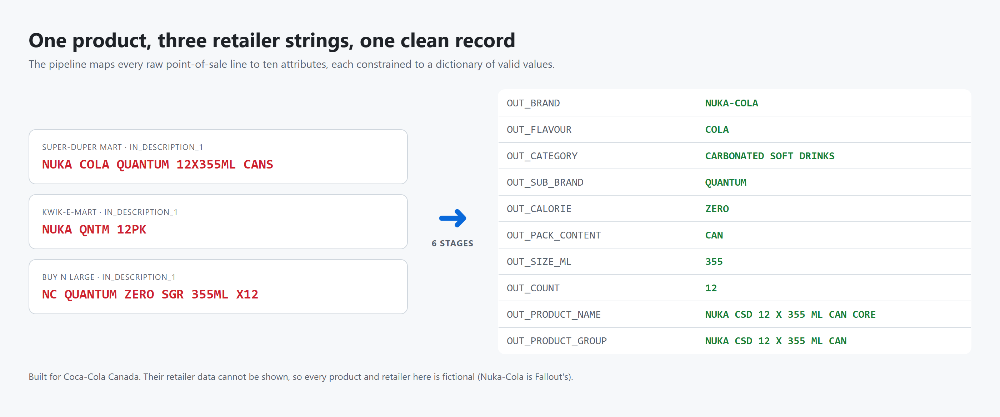
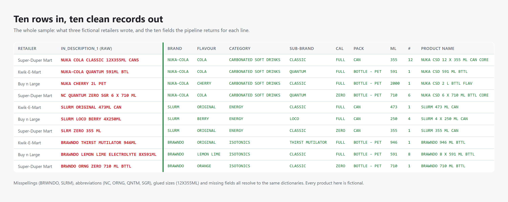
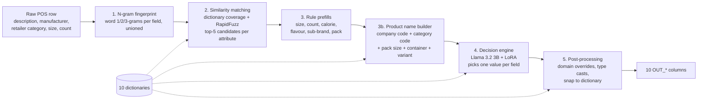
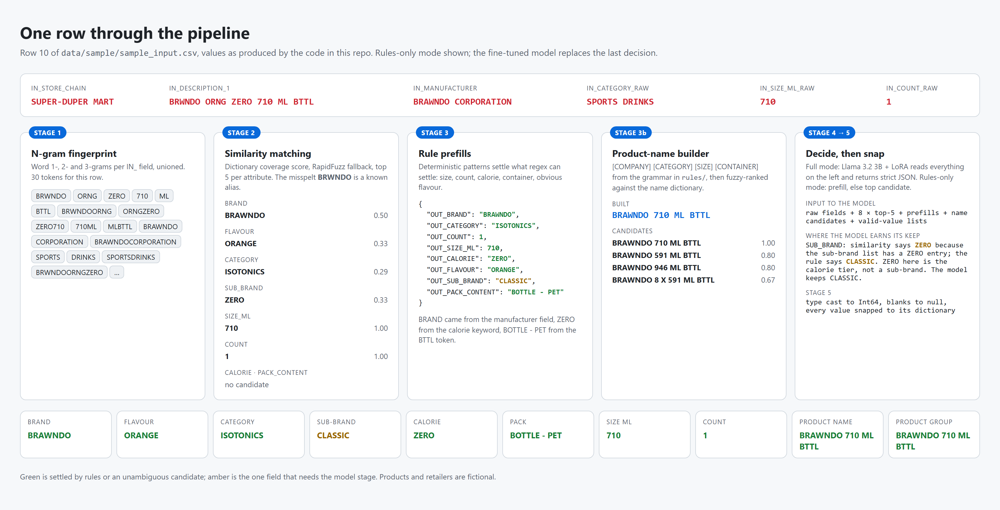
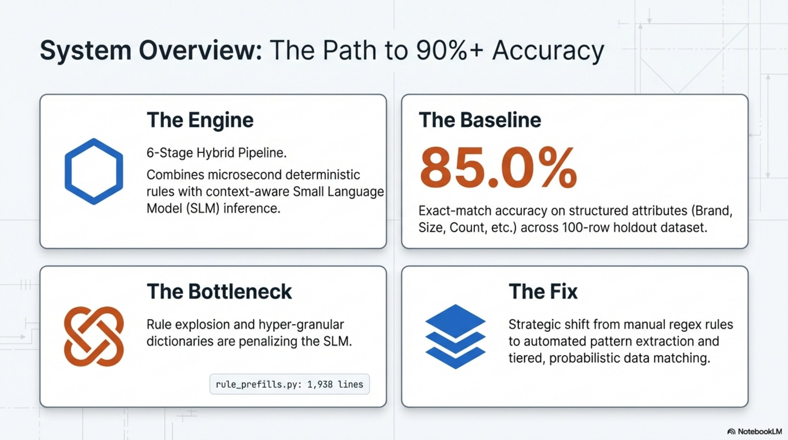
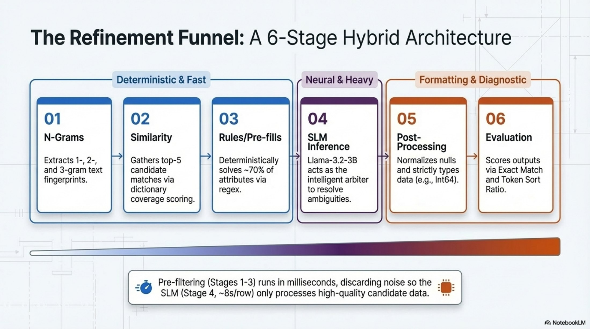
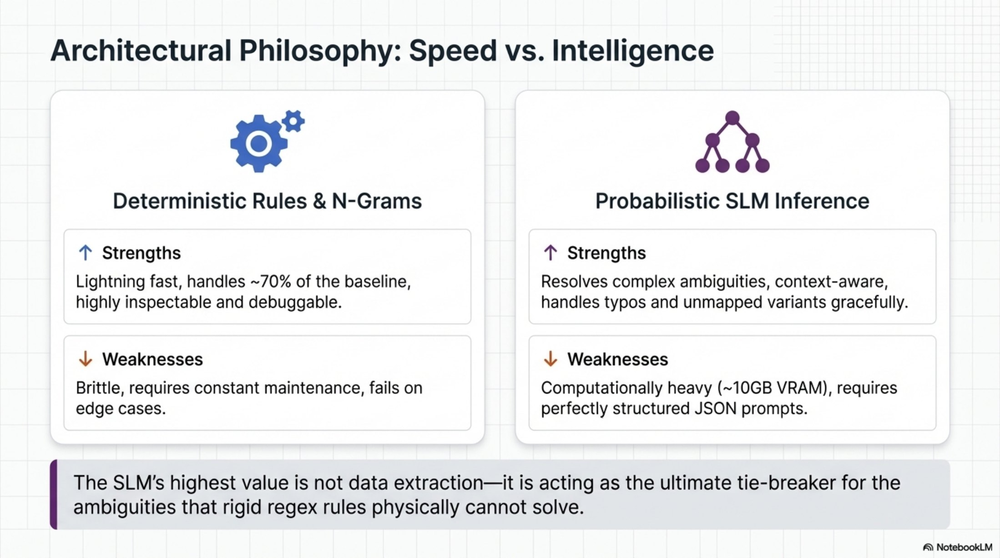
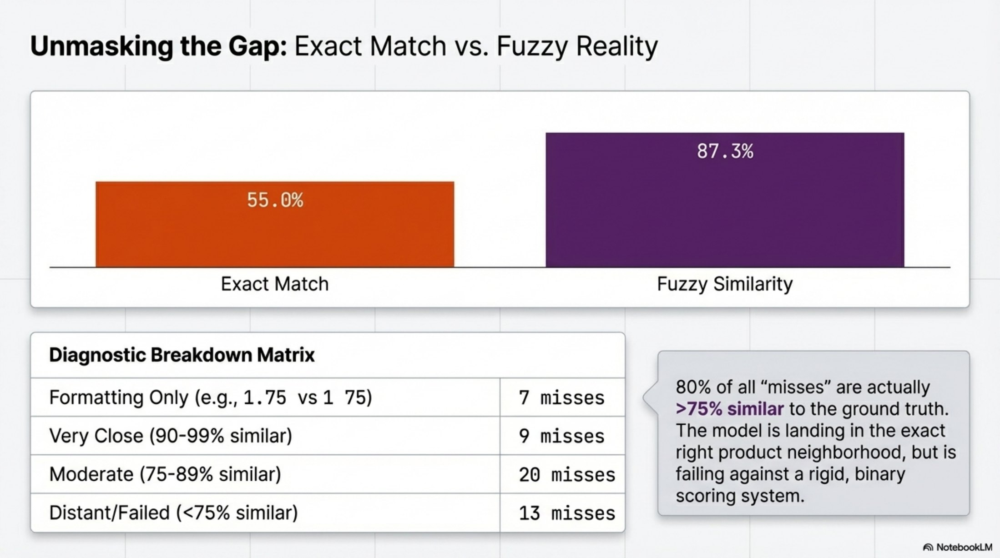
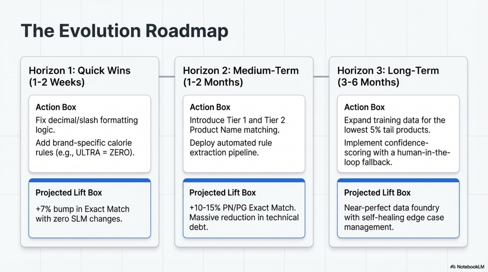

<h1 align="center">POS CleanScan</h1>

<p align="center">
  <b>Messy retailer point-of-sale strings in, ten clean product attributes out.</b><br/>
  A six-stage hybrid pipeline: n-gram fingerprints, fuzzy dictionary matching, rules, a product-name grammar, and a LoRA fine-tuned Llama 3.2 3B that makes the final call on every field.
</p>

<p align="center">
  <a href="#test-data">Test data</a> ·
  <a href="#end-to-end-workflow">Workflow</a> ·
  <a href="#the-trained-model">Model</a> ·
  <a href="#training">Training</a> ·
  <a href="#results">Results</a> ·
  <a href="#the-presentation">Presentation</a> ·
  <a href="#run-it">Run it</a>
</p>

<p align="center">
  
</p>

## The problem

Built with Coca-Cola Canada as the capstone project of Queen's Master of Management in Artificial Intelligence, class of 2026. Coke buys point-of-sale data from retailers, and every retailer describes the same can of pop differently. `NUKA COLA QUANTUM 12X355ML CANS`, `NUKA QNTM 12PK`, `NC QUANTUM ZERO SGR 355ML X12`: one product, three strings, no shared key. Before the data can be stored against Coke's master data or used for analytics, every string has to be mapped to the right product, and that mapping was done by hand.

The previous answer was a catalogue of 1,938 lines of deterministic rules and regex, which worked for high-volume products and collapsed under a long tail of 6,976 UPCs and 939 distinct flavour values. A trial with a hosted large model scored 57.7% on flavour, was slow, and sent retailer data off-site.

CleanScan is the replacement: a six-stage hybrid pipeline that turns each raw line into ten canonical fields, every one constrained to a dictionary of valid values, with a locally hosted small language model making the final call. Brand, flavour, category, sub-brand, calorie tier, pack content, size, count, product name and product group.

## What is in this repo

| You want | Where |
|---|---|
| Test data: ten invented rows and their expected output | `data/sample/sample_input.csv`, `docs/sample_output.csv` |
| The end-to-end workflow, runnable without a GPU | `raw_pos_parsing.py --rules-only` and the stage modules |
| The trained model | `models/pos-slm-llama3b/adapter/` plus the weights on the [v1.0-adapter release](https://github.com/bjjkim91-dev/pos-cleanscan/releases/tag/v1.0-adapter) |
| Training code | `training/build_sft_dataset.py`, `training/train_lora.py` |
| The presentation | `docs/slides/`, five slides on architecture, results and roadmap |

The project ran on Coca-Cola Canada's retailer extracts and master-data dictionaries, which cannot be published. Everything data-shaped here is fictional, and the rule base and name grammar are reduced to illustrative versions. The pipeline code, the model and the presentation are the real ones.

## Test data

Ten rows in `data/sample/sample_input.csv`, written the way retailers write them: misspellings (`BRWNDO`, `SLRM`), abbreviations (`NC`, `ORNG`, `QNTM`, `SGR`), glued sizes (`12X355ML`) and blank fields. The products are fictional on purpose, Nuka-Cola, Slurm and Brawndo, as sold by three fictional retailers. `docs/sample_output.csv` is the expected clean record for each row and doubles as a truth file for `evaluate.py`.



## End-to-end workflow



**Why hybrid.** Rules are fast and right for the head of the distribution: `12X355ML` is always 12 cans of 355 ml. They fail at the tail, where `FRIDGE MATE` is a pack format rather than a flavour, `ZERO` is a calorie tier on one line and a sub-brand on another, and a juice carton has no keyword at all. Rather than keep adding regexes, the pipeline hands the model everything it knows about a row and lets it choose. The model never generates free text; the output is snapped back to the dictionaries.

### One row, stage by stage

Every value below was produced by the code in this repo on the `BRWNDO ORNG ZERO 710 ML BTTL` row. Stage 1 breaks the text into n-grams. Stage 2 scores those against each dictionary and keeps five candidates per attribute; the misspelt brand still matches because `BRWNDO` is a known alias, and `ZERO` wrongly surfaces as a sub-brand. Stage 3 runs the rule base, which settles brand, size, calorie, flavour and pack. Stage 3b assembles the product name from a grammar and ranks it against the name dictionary. Stage 4 decides, stage 5 snaps.



### The six stages

| Stage | What happens | Module |
|---|---|---|
| 1. N-gram fingerprint | Each `IN_*` field is uppercased, stripped and split into word 1-, 2- and 3-grams, then unioned per row | `process_input.py`, `ngram_builder.py` |
| 2. Similarity matching | Coverage score = share of a dictionary entry's fingerprint found in the row, RapidFuzz fallback for misspellings, top 5 per attribute | `similarity_matcher.py` |
| 3. Rule prefills | Deterministic patterns for size, count, calorie, flavour, sub-brand and pack; high-confidence defaults for the model | `rule_prefills.py` |
| 3b. Name builder | `[COMPANY] [CATEGORY] [SIZE] [CONTAINER] [VARIANT]` from `rules/product_name_rules.json`, ranked against the name dictionary | `product_name_builder.py` |
| 4. Decision | One JSON payload per row in, strict JSON for ten fields out | `decision_engine.py`, `inference.py` |
| 5. Post-processing | Domain overrides, null cleanup, type casting, snap every value to its dictionary | `inference.py` |
| 6. Evaluation | Exact match for the eight structured fields, token-sort similarity for the two names | `evaluate.py`, `eval_scoring.py` |

Stage-by-stage internals, including the scoring formula and the product-name grammar, are in `PIPELINE_DETAIL.md`.

## The trained model

| | |
|---|---|
| Base | `unsloth/Llama-3.2-3B-Instruct` |
| Adaptation | LoRA, rank 32, alpha 16, dropout 0.05, on q, k, v, o, gate, up and down projections |
| Quantisation | 4-bit NF4 through bitsandbytes, about 10 GB of VRAM |
| Decoding | Greedy, so output is deterministic |
| Input | A JSON payload per row: raw fields, candidates with scores, prefills, name candidates, and the full valid-value lists in the system prompt |
| Output | Strict JSON with the ten fields, then snapped to the nearest dictionary value |
| Throughput | About 7 rows a minute on an RTX 3060 |

The adapter config, chat template and model card are in `models/pos-slm-llama3b/adapter/`. The weights are 195 MB, over GitHub's file limit, so they and the 17 MB tokenizer are attached to the [v1.0-adapter release](https://github.com/bjjkim91-dev/pos-cleanscan/releases/tag/v1.0-adapter) and fetched with one command:

```bash
python models/download_adapter.py      # downloads the weights and tokenizer, verifies each SHA-256
```

A hosted frontier model was tried first and rejected: it scored 57.7% on flavour, was slow, and sent retailer data off-site. A small local model fine-tuned on Coke's own labelled history beat it on the fields that matter and runs on a desktop GPU, about 7 rows a minute, so a 1,000-row batch takes roughly 2.5 hours. The model card is in the adapter folder.

## Training

Two scripts, described in `training/README.md`:

```bash
python training/build_sft_dataset.py data/sample/sample_input.csv docs/sample_output.csv training/sft_sample.jsonl
python training/train_lora.py training/sft_train.jsonl
```

The dataset builder runs stages 1 to 3b and writes one chat example per row, so the model trains on exactly the payload it sees at inference. `training/sft_sample.jsonl` is that output on the ten fictional rows. The trainer reads the LoRA shape from the shipped adapter config and fine-tunes the 4-bit base with TRL. The original training notebook was not kept in the handover, so the trainer is a reconstruction with the same configuration; the dataset builder reuses the pipeline's own code.

## Results

Blind holdout of 1,023 real retailer rows, from the final report. Macro accuracy and macro recall per attribute:

| Attribute | Macro accuracy | Macro recall |
|---|---|---|
| **Overall, 9 attributes** | **79.1%** | **60.0%** |
| Count | 89.6% | 72.5% |
| Brand | 88.2% | 85.9% |
| Size (ml) | 84.8% | 76.6% |
| Product name | 81.7% | 80.9% |
| Calorie | 81.3% | 44.8% |
| Category | 78.2% | 55.0% |
| Pack content | 76.2% | 43.6% |
| Sub-brand | 74.8% | 21.5% |
| Flavour | 57.5% | 40.1% |

That is about a 30-point lift in SKU-level accuracy over the rule-based system it replaced, at zero API cost, on a single RTX 3060. An earlier 100-row engineering checkpoint, the one the slides below were built from, measured 85.0% exact match on the eight structured attributes.

Where it misses, and why:

- **The long tail.** Accuracy falls from head to tail for eight of nine attributes. Sub-brand goes from 95.1% on frequent values to 18.8% on values seen fewer than five times, and flavour has 320 tail classes across 462 rows. The model simply did not see enough of them in training.
- **Formatting, not meaning.** Most product-name misses are over 75% similar to the truth. A missing decimal point or slash is a 0% exact match on a string the model got right.
- **Dictionaries too fine.** Over half the product-group values have a near-twin differing by one token, so the model is asked to pick between near-identical strings from imperfect text.

The recommendations handed over with the project: route low-confidence predictions to a human and treat them as new-product signals, keep the master data and training set refreshed through a CI/CD loop, consolidate the flavour and sub-brand taxonomies, and move to a larger model on proper hardware. `evaluate.py` reproduces the scoring on any predictions file with a truth file.

## The presentation

Five slides from the project's engine-evolution deck that say what the README cannot in a sentence: the shape of the system, why rules alone broke, and where it goes next.



*The overview. A six-stage hybrid pipeline, a measured baseline, and the diagnosis that rule explosion and over-fine dictionaries were penalising the model.*



*The funnel. Stages 1 to 3 are deterministic and run in milliseconds; stage 4 is the model; stages 5 and 6 format and score.*



*Why hybrid. Rules are fast and inspectable but brittle; the model handles typos and unmapped variants but is heavy. Each covers the other's weakness.*



*The gap. Product names score 55% on exact match but 87% on similarity: most misses are formatting, and the model is landing in the right place.*



*The roadmap. Quick formatting fixes, then tiered product-name matching and automated rule extraction, then confidence scoring with a human in the loop.*

## Run it

Rules only, on a laptop with no GPU:

```bash
pip install pandas rapidfuzz
python tools/make_synthetic_dictionaries.py          # writes the 10 stand-in dictionaries
python raw_pos_parsing.py data/sample/sample_input.csv --rules-only
python evaluate.py output/result_sample_input_slm.csv docs/sample_output.csv
```

`--rules-only` runs stages 1 to 3b and 5 and resolves each field from the prefills and the best similarity candidate, skipping the model. The rule set here is a small illustrative one, so expect it to settle the easy fields and leave the rest to the candidates. A few sample rows show why stage 4 exists:

| Input | What rules and matching alone get wrong | What the model is for |
|---|---|---|
| `NC QUANTUM ZERO SGR 6 X 710 ML` | No rule knows `NC`, and nothing says bottle | Matching reads the manufacturer field for the brand; the model knows 710 ml is a bottle |
| `SLRM ZERO 355 ML` | `ZERO` surfaces as a sub-brand candidate | The model keeps it as the calorie tier and leaves sub-brand `CLASSIC` |
| `BRWNDO ORNG ZERO 710 ML BTTL` | Misspelt brand, abbreviated flavour | Aliases catch both; the model confirms the rest |

Full pipeline, with a CUDA GPU:

```bash
pip install -r requirements.txt
python models/download_adapter.py
python raw_pos_parsing.py your_rows.csv                       # full pipeline
python evaluate.py output/result_your_rows_slm.csv truth.csv  # scoring
```

Input columns: `IN_STORE_CHAIN`, `IN_UPC`, `IN_DESCRIPTION_1` are required; `IN_DESCRIPTION_2`, `IN_MANUFACTURER`, `IN_PRODUCT`, `IN_CATEGORY_RAW`, `IN_SIZE_ML_RAW`, `IN_COUNT_RAW` improve results.

## What is and is not here

- **In**: all pipeline code, the evaluation code, the trained adapter (config here, weights on the release), the training scripts, five presentation slides, a generator for synthetic dictionaries.
- **Replaced**: the ten dictionaries are generated from a hand-written vocabulary of fictional drinks (`tools/make_synthetic_dictionaries.py`). The rule base and the product-name grammar are reduced to a small illustrative set with the same structure and interfaces; the production versions, 700+ patterns and the full manufacturer and retailer-category maps, were written from the partner's data. The ten sample rows and their expected output are invented, down to the brands and the retailers.
- **Out**: Coke's retailer extracts, the labelled training rows, the ground-truth and holdout files, and the written reports.

```
raw_pos_parsing.py        entry point, stages in order, --rules-only switch
process_input.py          stage 1
ngram_builder.py          word n-gram fingerprints
similarity_matcher.py     stage 2
rule_prefills.py          stage 3, the rule base
product_name_builder.py   stage 3b, name and group grammar driven by rules/product_name_rules.json
decision_engine.py        stage 4 payload and system prompt
inference.py              stage 4 model loading, generation, dictionary snapping
evaluate.py, eval_scoring.py   stage 6
training/                 dataset builder, LoRA trainer, sample JSONL
models/                   adapter config, tokenizer, model card, weight downloader
tools/make_synthetic_dictionaries.py
data/sample/sample_input.csv
docs/                     walkthrough images, five slides, expected output
```

## License

MIT for the code. Llama 3.2 and the adapter are used under the Llama 3.2 Community License.
